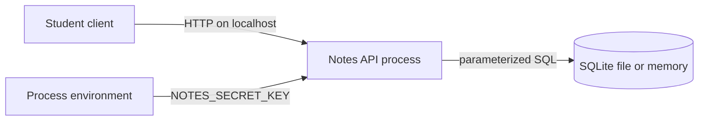

# Threat model

This is a lightweight STRIDE analysis of the secure-notes lab as it is built today. It is a design record, not a claim that the lab is safe to deploy. STRIDE is a prompt for the conversation: spoofing, tampering, repudiation, information disclosure, denial of service, and elevation of privilege.

The system under analysis is one Python process. It serves a small HTTP API, stores data in SQLite, and reads a server secret from the environment. Students run it on a laptop for coursework.

## Assets

| Asset | Why it matters |
| --- | --- |
| Password hashes | They are the long-term authenticator for an account. A copied database should not reveal the password. |
| Bearer tokens | Whoever presents a live token is treated as the user. |
| Server secret (`NOTES_SECRET_KEY`) | It keys the HMAC that turns a bearer token into the value stored in SQLite. |
| Note title and body | The content a user expects only they can read through the API. |
| Audit events | The record of registrations, logins, and note access. They are useful only if they are trustworthy and free of secrets. |
| Availability of the local process | A coursework server can still be wedged by an unbounded request. |

Note contents are an asset even though this lab stores them in plaintext. The access-control boundary is the API, not the disk.

## Trust boundaries

Three boundaries matter:

1. **Client to API.** The browser, script, or test runner is untrusted. Headers, JSON, and URL paths are data until the server checks them.
2. **API to SQLite.** The database is trusted to store bytes and return them. It is not trusted to enforce every product rule by itself, so ownership is also checked in the service. Anyone who can read the database file is outside the API's access-control story.
3. **Operator to environment.** The person who starts the process is trusted to supply a fresh secret and to keep the terminal and the database file private. The application cannot protect a secret that was pasted into a chat or committed to git.

The lab does not trust `X-Forwarded-For`. A client can set that header to any value, so the rate limiter uses the connection's peer address.

## Entry points

| Entry point | What crosses it |
| --- | --- |
| `POST /auth/register` | Username and password |
| `POST /auth/login` | Username and password |
| `POST /notes`, `GET /notes`, `GET /notes/{id}`, `DELETE /notes/{id}` | Bearer token and, on create, note text |
| `GET /health` | Nothing sensitive; still an unauthenticated request |
| Process environment | `NOTES_SECRET_KEY` and optional settings |
| SQLite path | The file named by `NOTES_DATABASE_PATH`, or a private in-memory database in tests |

There is no search route, no outbound HTTP client, no file upload, and no admin route that reads the audit log. Those absences are deliberate. Each one would be another entry point.

Interactive API documentation is disabled. The route list lives in the README so the process does not publish a second description of itself.

## Threat actors

| Actor | Relationship to the lab |
| --- | --- |
| Account holder | Uses their own notes. May be careless with a token. |
| Another student | Has a different account, or no account, on the same local server. Curious or mistaken, not a remote intrusion scenario. |
| Person with a shell on the same machine | Can read environment variables, process memory, and the SQLite file if file permissions allow it. |
| Course operator | Starts the process and can read the database. Trusted to handle the secret and the audit log. |

This model does not include an anonymous attacker on the public internet. The server is bound to `127.0.0.1` and speaks plain HTTP. Putting it on a shared network would change the model and is out of scope.

## Threats and mitigations

| STRIDE | Threat in this lab | Mitigation in the code | What remains |
| --- | --- | --- | --- |
| Spoofing | Guess or replay a password or a bearer token. | Argon2id password hashes with a per-hash salt. Login failures share one message. Unknown users still run a password verification so the missing-user path is not a cheap shortcut. Tokens are 32 random bytes. SQLite stores HMAC-SHA256(token), not the token. Sessions expire. | No second factor. A stolen token works until it expires. The first missing-user verification in a process pays for a dummy hash; later ones do too, but this is not a formal timing proof. |
| Spoofing | Client supplies `owner_id` and writes into someone else's account. | The owner is taken from the session. `owner_id` in the JSON body is an unexpected field and is rejected. | A bug that trusted the body would remove this control. Tests cover the extra field. |
| Tampering | Change a request so SQL text is executed. | Queries use `?` placeholders. Note ids must be UUIDs before they are used. A string that looks like SQL is stored as a title or body. | The schema script is fixed text in the source file. A later change that builds SQL with an f-string would bypass this. |
| Tampering | Edit the SQLite file. | None at the storage layer. | The file is not signed or encrypted. A local editor can change rows. |
| Repudiation | Deny that an account was created or a note was opened. | Audit rows record the event type, outcome, actor id, and resource id. The logger redacts known secret fields and bearer spellings. | The audit log sits in the same database as the notes. A person who can change the database can change the log. Clock source is the local machine. |
| Information disclosure | One user reads another's note. | Reads and deletes require a session and an owner match. Missing notes and notes owned by someone else both return "Note not found". List returns only the caller's rows. Delete uses `id` and `owner_id` together. | The database file contains every note in plaintext. Process memory does too, while a request is handled. |
| Information disclosure | An error or a log line returns a password, token, or note. | Validation errors omit submitted values. Unhandled exceptions return a fixed sentence and log only the exception type. Audit columns cannot hold a note body. The audit writer rejects identifiers that are not lab ids. | Redaction cannot recognize an arbitrary string. A new log line that interpolates a password would not be stopped by the field list. Proxy logs are outside this process. |
| Information disclosure | The password hash or server secret is sent to the client. | Responses use explicit models: account id and username, or a token, or a note. The hash and the secret are not fields on those models. | Anyone who can read the process environment or the database can still see them. |
| Denial of service | Repeated login or registration attempts. | A fixed-window limiter sits in front of those two routes. The limit is per peer address and path. `Retry-After` is set on rejection. Password length is capped before hashing. | The limiter is in-memory and single-process. It resets on restart. It is not shared across workers. Many source addresses mean many windows. |
| Elevation of privilege | A normal user reaches another user's notes or an audit feed. | There is no role flag and no audit HTTP route. Authorization is "this session's user id matches `owner_id`." | The operating-system user who owns the database file has more power than any account. That is outside the API. |

## Residual risk

These are accepted limits of the teaching project. They are not a backlog that this repository quietly finished.

* **Not production-ready.** No TLS, no operational monitoring, no backup plan, no multi-worker story, and no review of a real deployment.
* **Plaintext notes at rest.** The cryptography lab shows AES-GCM with a trusted library. The notes table does not use it. Encryption at rest would also require a key-management story this lab does not have.
* **Local attackers win.** A person who can read the SQLite file, the environment, or process memory can read notes and the server secret.
* **Bearer tokens are bearer tokens.** Theft of the token is theft of the session until expiry. Logout is not implemented; expiry and process restart are the ends of a session. Restart drops memory databases and leaves file-database sessions in place until they expire.
* **Rate limiting is a local counter.** It will not stop a distributed flood, and it does not lock an account.
* **No account recovery and no second factor.**
* **Audit log shares fate with the database.** It is also not independently shipped to a log store.
* **Username policy is a character class.** It is not an identity system.
* **Dependency risk remains.** CI runs `pip-audit` when the tool is installed. A later release of a dependency can still be vulnerable.
* **HSTS is intentionally absent.** The lab speaks HTTP on localhost. Sending Strict-Transport-Security from this process would tell a browser to remember an HTTPS rule the lab cannot satisfy.
* **Documentation and tests can drift.** A passing suite says the checks that exist still pass. It does not say every future route will keep them.

## How to revise this model

Add a row when a feature adds an entry point. A URL fetcher, a file upload, a shared link, or an AI summary of a note would each change the assets, the trust boundary, and the residual risk. Update the model in the same change as the code.
